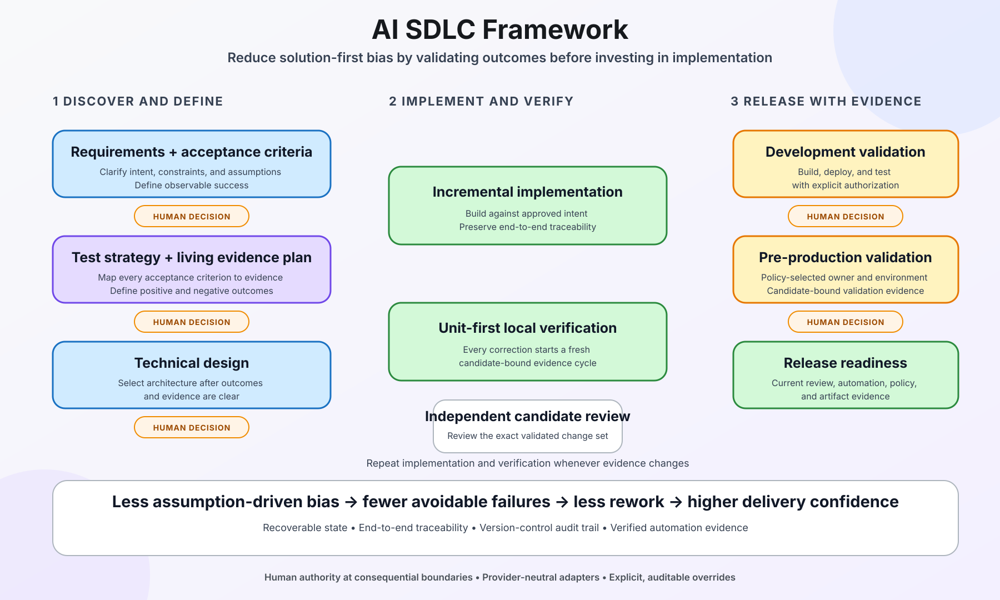

# AI SDLC Framework

AI SDLC Framework brings a user-governed engineering workflow to GitHub Copilot
CLI, with integration support for **GitHub** and **Azure DevOps**.

It connects requirements, test planning, implementation, review and delivery
with recoverable project context and traceable execution evidence, including
workflows using **GitHub Actions** and **Azure Pipelines**. Developers retain
control over consequential decisions while using their own repositories,
test runners and CI/CD.

Installable instructions, skills and hooks work with an offline CLI.
Authorized host tools perform external operations; the framework is not a
separate coding model or a replacement for provider access controls.

This is [urmich](https://github.com/urmich)'s personal, community-maintained third-party OSS
project, licensed under [MIT](LICENSE). It is not a Microsoft product,
sponsorship, approval or corporate support commitment.

## Why use it?

- **Reduce solution-first coding.** Clarify requirements and observable
  acceptance conditions, then plan tests and design before implementation.
- **Make readiness explainable.** Connect requirements, actual test outcomes
  and the reviewed candidate instead of relying on an agent's "done" claim.
- **Continue without starting over.** Resume from canonical project documents,
  retained decisions and original execution results rather than chat memory alone.
- **Keep consequential choices yours.** Record approvals and scoped exceptions;
  keep PR publication, merge and environment delivery separately authorized.
  Stages remain advisory, and you can explicitly skip or reorder them.

## Capabilities

The table covers the implemented capability families in the **0.5.0 release
candidate**. Provider-specific scopes and host prerequisites are linked below.

| Capability | What it helps you do | Learn more |
| --- | --- | --- |
| Requirements, test planning and design | Clarify intent and acceptance conditions; maintain one living Test Plan and a Technical Design before implementation. | [Workflow](docs/usage/README.md) |
| Implementation and unit-first validation | Guide Coding and candidate-changing fixes through the project's required local checks, with actual per-test outcomes. | [Validation](docs/reference/cli.md#local-validation-and-environment-records) |
| Candidate code review | Use built-in Copilot `/review` for the validated candidate; corrections restart the required validation and review cycle. | [Candidate review](docs/reference/cli.md#candidate-review-through-copilot-cli-review) |
| Session recovery | Recover authoritative documents, current work, pending execution handles and historical results after a restart or context loss. | [Resume and recovery](docs/usage/README.md#resume-from-authoritative-records) |
| Explicit user decisions | Record approvals, scoped overrides and receipt-backed decisions without treating tool success or document labels as consent. | [Decisions and receipts](docs/reference/cli.md#decisions-and-receipts) |
| Multi-repository and multi-document work | Bind each repository/branch and track separate requirements, plans and designs under one coordinator. Local-only work needs no remote. | [Identity and artifacts](docs/reference/cli.md#identity-artifacts-and-recovery) |
| Execution evidence and readiness | Normalize real producer results, retain individual outcomes and evaluate source/specification/configuration-bound readiness. Missing or stale evidence is not a pass. | [Evidence integration](docs/usage/evidence.md) |
| Requirements-to-tests traceability | Connect acceptance conditions to declared tests, expose coverage gaps and generate a PR-description coverage section. A mapping is not proof of execution. | [Coverage guide](docs/usage/evidence.md#1-author-canonical-definitions-and-compile-coverage-in-memory) |
| GitHub integration | Use dedicated connection, transport and trusted-host/Store adapters for repository, PR, run, check and artifact observations. | [GitHub integration](docs/integrations/github-adapters.md) |
| Azure DevOps integration | Use the built-in build identity/run-link adapter and provider-neutral PR, check, monitoring and evidence consumers. | [Azure DevOps adapter](docs/integrations/provider-adapters.md#azure-devops-reference-adapter) |
| GitHub Actions and Azure Pipelines | Track authorized workflow/build runs, associate PR checks and retain execution/artifact evidence bound to the actual source and run. Provider tools own pipeline dispatch. | [Pipeline integration](docs/integrations/README.md#pipeline-integration) |
| Pipeline monitoring | Follow GitHub Actions, Azure Pipelines and other supported reported runs with 60-second polling when a running host provides a scheduler and authorized provider-read tools. | [Monitoring prerequisites](docs/getting-started/README.md#monitoring-is-a-host-capability) |
| PR and remote-operation tracking | Bind authorized pushes, PRs and provider results to exact source, destination and request identities; reconcile uncertain effects before retrying. | [Operations](docs/reference/cli.md#exact-external-operations) and [PR records](docs/reference/cli.md#pr-records) |
| DEV and STAGING delivery | Track deployment-bound tests, separate environment permissions and explicit execution owner/location contracts. PROD is never automatic. | [Environment records](docs/reference/cli.md#local-validation-and-environment-records) |
| Artifact and release handoffs | Carry supported artifact/version, producer, environment and destination identities into separately authorized delivery and release steps. | [Integration contracts](docs/integrations/provider-adapters.md) |
| Provider and test-producer adapters | Extend trusted observation/result normalization and integrate the project's own runners without installing this repository's CI policy. | [Provider adapters](docs/integrations/provider-adapters.md) and [evidence adapters](docs/usage/evidence.md#3-normalize-actual-producer-output) |
| Policy and notification result tracking | Record verified results of separately authorized policy or notification actions. Provider tools own the changes and sends. | [Supported result families](docs/integrations/provider-adapters.md) |
| Configuration and conflict resolution | Map project commands, tools and pipeline environments; record opposing rules and resolve them through explicit scoped decisions or verified corrections. | [Configuration and conflicts](docs/reference/cli.md#configuration-and-conflicts) |
| Audit and conformance checks | Inspect recorded authority, replay supported Git audit trailers and diagnose state/history/evidence gaps without turning unknown results into passes. | [Audit and conformance](docs/reference/cli.md#audit-and-conformance) |
| Offline core and local-only work | Use local Git projects without a remote; keep framework records in the selected Copilot home without a built-in cloud-provider client. | [Architecture](docs/architecture/README.md) |
| Installation, updates and diagnostics | Choose a Copilot home, run doctor, update or uninstall owned assets, and preserve runtime state and unrelated files during ordinary maintenance. | [Installation](docs/installation/README.md) |
| Cross-platform distribution | Use npm on Windows, macOS and Linux; check standalone/Homebrew channel availability and external runtime requirements before choosing a release. | [Channels and homes](docs/installation/README.md#choose-a-channel-and-home) |

**Availability:** The new reusable evidence/readiness and coverage interfaces
above are included in the **0.5.0 release candidate**, not the published
**0.4.0** package. See [runtime and installation](#runtime-and-installation)
before choosing a version.

Provider integrations have different adapter scopes, described in
[integration support](docs/integrations/README.md). The framework guides work
and records decisions/evidence. It does not replace
Copilot permissions, OS/sandbox controls, provider access controls or repository
rules, and installing it does not impose this repository's CI policy on yours.



## Start here

- [Documentation](docs/README.md): installation, usage, architecture and reference.
- [Contributing](CONTRIBUTING.md): local checks, complete hosted validation and PRs.
- [Support](SUPPORT.md), [security reporting](SECURITY.md) and
  [conduct](CODE_OF_CONDUCT.md).
- [Ownership and review](OWNERSHIP.md), [releases](RELEASING.md) and
  [change history](CHANGELOG.md).

## Runtime and installation

The release candidate is **0.5.0**, not yet published. The current npm `latest`
is **0.4.0**; it does not include the new evidence/coverage interfaces.
Node.js **22 or later**, Git, npm and
GitHub Copilot CLI's documented instruction/skill/hook extension points are
required. The offline CLI has no runtime package dependencies or built-in
cloud-provider network client; authorized host tools own external operations.

The primary npm channel works on Windows, macOS and Linux with a supported Node
runtime. After 0.5.0 publication and public-consumer verification, use this exact
version for a deliberate installation into your chosen Copilot home:

```sh
npx --yes --registry=https://registry.npmjs.org --package=ai-sdlc-framework@0.5.0 sdlc install
```

Until then, use the [source-candidate installation](docs/installation/README.md#choose-a-channel-and-home)
in an isolated home, or install the existing release with its older capabilities:

<!-- historical:start -->
```sh
npx --yes --registry=https://registry.npmjs.org --package=ai-sdlc-framework@0.4.0 sdlc install
```
<!-- historical:end -->

Next, run doctor through the **installed entry**, restart Copilot, and try a
local-only request in a disposable repository:
[safe first use and activation checks](docs/getting-started/README.md#safe-first-use).
An active process retains its loaded hooks and instructions. Doctor checks
installation integrity; it does not certify live Copilot or platform compatibility.
Ordinary updates preserve runtime state.
Destructive purge is not the default; see [installation](docs/installation/README.md).
Never use your live Copilot home for contributor validation.

Published **0.4.0 is immutable**. Its Windows x64 PE and separate Apple Silicon /
Intel Mac standalone artifacts remain historical release content. The next
release design uses **one shared macOS artifact** containing one portable
JavaScript payload and shell launcher, with external native Node on each Mac.
It is **not Universal 2** and includes **no bundled Node runtime**.
Windows keeps its separate PE archive, npm
remains the primary channel, and there is no Linux standalone distribution.
Future distribution source is not proof of native or public-consumer acceptance.

## Workflow and trust

1. Requirements and observable requirement-specific definitions of done.
2. One living Test Plan before Technical Design.
3. User-authorized Coding with unit-first local corrections.
4. Built-in Copilot CLI `/review` of the validated candidate.
5. Separately authorized PR publication, DEV and STAGING; no automatic PROD.

Stages are advisory: users may explicitly skip or reorder them. Overrides never
create host/provider permission, test evidence or approval. STAGING uses an
explicit execution contract selecting owner and location, followed by the
user's completion confirmation. Effective enforcement belongs to real host and
provider controls, not a framework hook.

Candidate-bound observations, immutable evidence and approvals remain distinct.
The 0.5.0 candidate's [generic evidence guide](docs/usage/evidence.md) describes
the new reusable producer normalization, readiness and PR-description coverage
interfaces. Those additions are included in the 0.5.0 source/package candidate but remain
unreleased; the published 0.4.0 package does not contain them.
Installing the framework never imposes this repository's CI policy on consumers.

## Contributor validation

Node >=22 is sufficient for source-only JavaScript checks; no dependency restore
is needed. The default local gate is a **small, explicit critical sanity set**,
unit tests first, followed by cheap static/document checks:

```sh
npm run test:critical
npm run check
```

Targeted or affected checks are an **optional debugging/iteration choice**, not
extra default-gate membership. For example:
`npm run test:targeted -- test/public-readiness-docs.test.mjs`.
`test:critical` already runs the exact three-file/16-case canonical unit stage
first, once. Use standalone `npm run test:unit` for a unit-only iteration, not
as an extra command immediately before that default sequence.
New tests are PR-only by default; a unit filename or pre-review label does not
make a test critical. In a source checkout, read `AGENTS.md` and
`.github/testing-policy.md` before changing classification. These repository-only
instructions are neither shipped nor installed as consumer framework policy.
`npm test` / `npm run test:full` and `npm run test:coverage` remain **opt-in locally**.
Every PR requires the complete applicable hosted native matrix: Linux shared
behavior, Windows x64, Apple Silicon macOS and Intel macOS. Release prepublication
and published-consumer cases are separate gates, not local contributor prerequisites.
See [testing and CI reproduction](docs/contributing/README.md).

## Released versus unreleased

The 0.5.0 installation command above is a postpublication command, not a claim
that the version is already available. This source
branch contains **unreleased** public-readiness work: reusable evidence and
coverage interfaces, a bounded test scheduler, native CI/release changes and the
shared Mac packaging design. Source presence is not publication, native
acceptance or proof of effective repository enforcement.

The [release guide](docs/releases/README.md#deferred-launch-limitations) lists
known deferred contributor/platform defects and the remaining publication gates.
Local validation and candidate review do not make this branch announcement-ready.

Reader guides live under `docs/`; canonical internal specifications live only
under `docs/sdlc/<feature>/`. Start with the [documentation map](docs/README.md)
and [release/change history](CHANGELOG.md).
