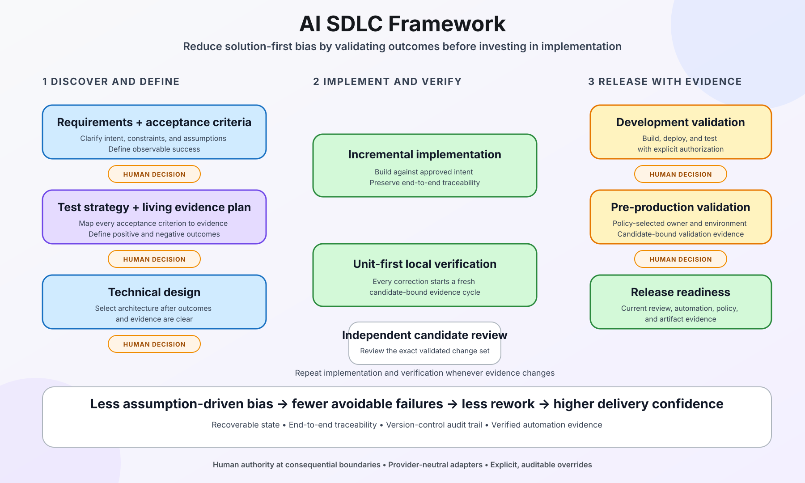

# AI SDLC Framework

A user-governed Software Development Life Cycle for GitHub Copilot CLI:
understand requirements, define their evidence, design, implement, validate and
review the exact candidate before separately authorized delivery.



This is Michael Urinovsky's personal, community-maintained third-party OSS
project, licensed under [MIT](LICENSE). It is not a Microsoft product,
sponsorship, approval or corporate support commitment.

## Start here

- [Documentation](docs/README.md): installation, usage, architecture and reference.
- [Contributing](CONTRIBUTING.md): local checks, complete hosted validation and PRs.
- [Support](SUPPORT.md), [security reporting](SECURITY.md) and
  [conduct](CODE_OF_CONDUCT.md).
- [Ownership and review](OWNERSHIP.md), [releases](RELEASING.md) and
  [change history](CHANGELOG.md).

## Runtime and installation

The current published version is **0.4.0**. Node.js **22 or later**, Git, npm and
GitHub Copilot CLI's documented instruction/skill/hook extension points are
required. The offline CLI has no runtime package dependencies or built-in
cloud-provider network client; authorized host tools own external operations.

The primary npm channel works on Windows, macOS and Linux with a supported Node
runtime. For a deliberate installation into your chosen Copilot home:

```sh
npx --yes --registry=https://registry.npmjs.org --package=ai-sdlc-framework@0.4.0 sdlc install
```

Next, run doctor through the **installed entry**, restart Copilot, and try a
local-only request in a disposable repository:
[safe first use and activation checks](docs/getting-started/README.md#safe-first-use).
An active process retains its loaded hooks and instructions. Doctor checks
installation integrity; it does not certify live Copilot or platform compatibility.
Ordinary updates preserve runtime state.
Destructive purge is not the default; see [installation](docs/installation/README.md).
Never use your live Copilot home for contributor validation.

Published **0.4.0 is immutable**. Its Windows x64 PE and separate Apple Silicon /
Intel Mac standalone artifacts remain historical release content. The next
release design uses **one shared macOS artifact** containing one portable
JavaScript payload and shell launcher, with external native Node on each Mac.
It is **not Universal 2** and includes **no bundled Node runtime**.
Windows keeps its separate PE archive, npm
remains the primary channel, and there is no Linux standalone distribution.
Future distribution source is not proof of native or public-consumer acceptance.

## Workflow and trust

1. Requirements and observable requirement-specific definitions of done.
2. One living Test Plan before Technical Design.
3. User-authorized Coding with unit-first local corrections.
4. Built-in Copilot CLI `/review` of the validated candidate.
5. Separately authorized PR publication, DEV and STAGING; no automatic PROD.

Stages are advisory: users may explicitly skip or reorder them. Overrides never
create host/provider permission, test evidence or approval. STAGING uses an
explicit execution contract selecting owner and location, followed by the
user's completion confirmation. Effective enforcement belongs to real host and
provider controls, not a framework hook.

Candidate-bound observations, immutable evidence and approvals remain distinct.
The source candidate's [generic evidence guide](docs/usage/evidence.md) describes
the new reusable producer normalization, readiness and PR-description coverage
interfaces. Those additions are unreleased, not an assertion that the published
0.4.0 package contains them.
Installing the framework never imposes this repository's CI policy on consumers.

## Contributor validation

Node >=22 is sufficient for source-only JavaScript checks; no dependency restore
is needed. The default local gate is a **small, explicit critical sanity set**,
unit tests first, followed by cheap static/document checks:

```sh
npm run test:critical
npm run check
```

Targeted or affected checks are an **optional debugging/iteration choice**, not
extra default-gate membership. For example:
`npm run test:targeted -- test/public-readiness-docs.test.mjs`.
`test:critical` already runs the exact three-file/16-case canonical unit stage
first, once. Use standalone `npm run test:unit` for a unit-only iteration, not
as an extra command immediately before that default sequence.
New tests are PR-only by default; a unit filename or pre-review label does not
make a test critical. In a source checkout, read `AGENTS.md` and
`.github/testing-policy.md` before changing classification. These repository-only
instructions are neither shipped nor installed as consumer framework policy.
`npm test` / `npm run test:full` and `npm run test:coverage` remain **opt-in locally**.
Every PR requires the complete applicable hosted native matrix: Linux shared
behavior, Windows x64, Apple Silicon macOS and Intel macOS. Release prepublication
and published-consumer cases are separate gates, not local contributor prerequisites.
See [testing and CI reproduction](docs/contributing/README.md).

## Released versus unreleased

The installation command above selects immutable published 0.4.0. This source
branch also contains **unreleased** public-readiness work: reusable evidence and
coverage interfaces, a bounded test scheduler, native CI/release changes and the
shared Mac packaging design. Source presence is not publication, native
acceptance or proof of effective repository enforcement.

Reader guides live under `docs/`; canonical internal specifications live only
under `docs/sdlc/<feature>/`. Start with the [documentation map](docs/README.md)
and [release/change history](CHANGELOG.md).
